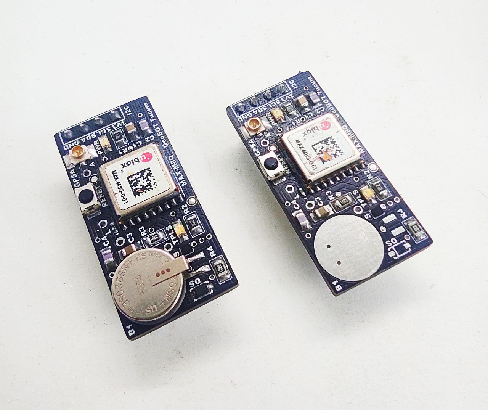
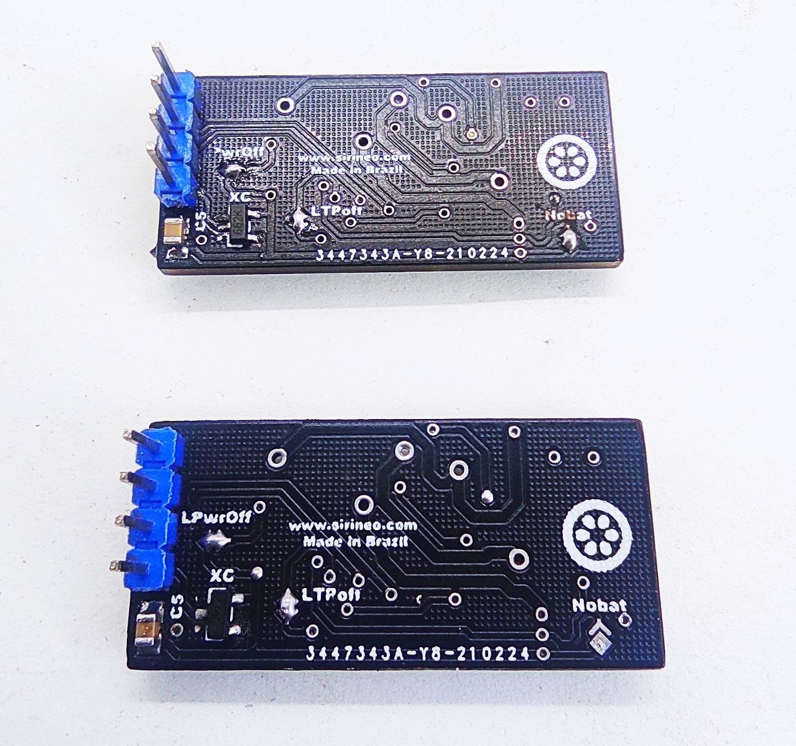
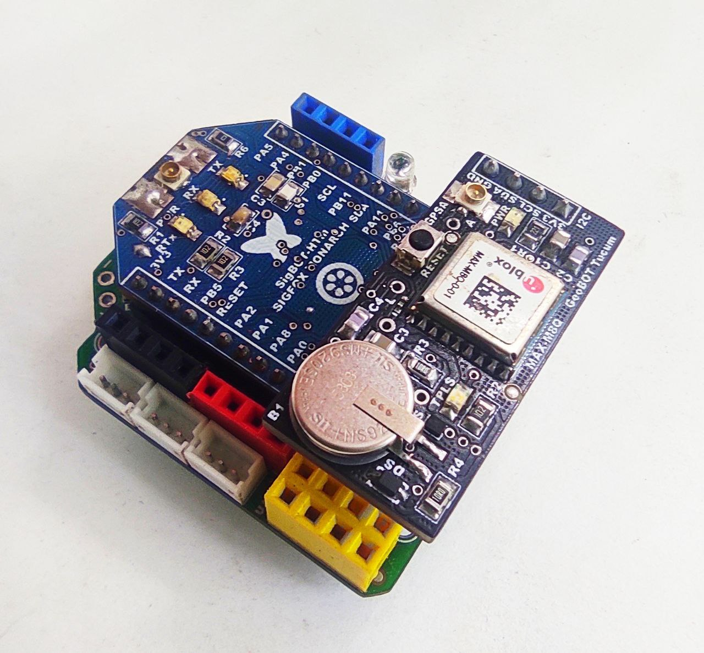
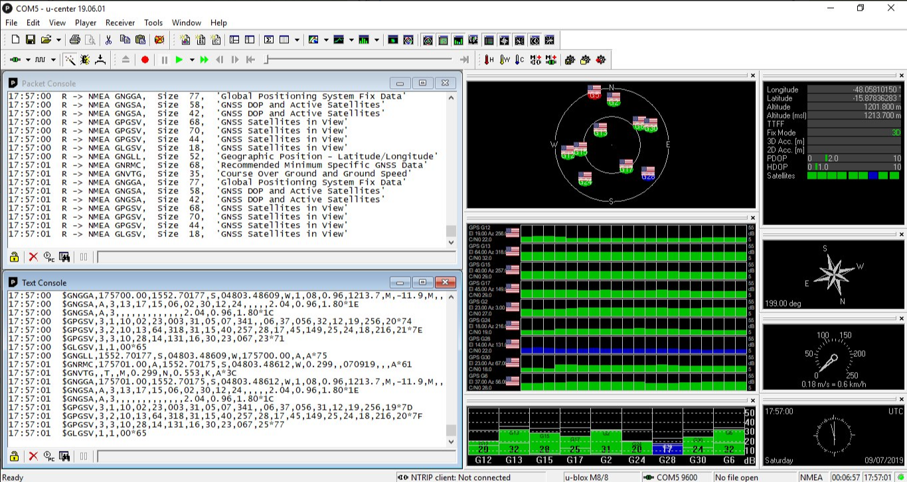

<h1 align="center">GeoBOT Tucum 🛰️</h1>

  

**GeoBOT Tucum** é uma placa de desenvolvimento GNSS desenvolvida e projetada no laboratório **BabaçuLABVicente** pela **SiriNEO Technologies**, para uso nas plataformas **JARMIoTM** e **JARMESP32IoT**.

O GeoBOT Tucum utiliza a série **MAX-M8** de módulos GNSS independentes com recepção concorrente. A série é construída sobre o desempenho excepcional do motor **u-blox M8** no fator de forma **MAX**, comprovado na indústria. Com front-end de RF para recepção concorrente de dois sistemas GNSS, o motor u-blox M8 é capaz de utilizar de forma inteligente a maior quantidade de satélites visíveis de dois sistemas GNSS (**GPS, GLONASS e BeiDou**) para um posicionamento mais confiável. A série MAX-M8 é ideal para aplicações orientadas a desempenho, oferecendo alta sensibilidade e tempos mínimos de aquisição, mantendo baixo consumo de energia do sistema.

## 🔧 Especificações do Receptor

*   **Tipo de receptor:** motor u-blox M8 de 72 canais
*   **Constelações suportadas:**
    *   GPS/QZSS L1 C/A
    *   GLONASS L10F
    *   BeiDou B1
    *   SBAS L1 C/A: WAAS, EGNOS, MSAS
*   **Recepção concorrente:** dois sistemas GNSS simultâneos (GPS, GLONASS e BeiDou)
*   **Fator de forma:** MAX (compatível com a série MAX)
*   **Sensibilidade:** alta sensibilidade
*   **Tempo de aquisição:** mínimo
*   **Consumo:** baixo consumo de energia do sistema

## 🔋 Modos de Operação e Backup

O GeoBOT foi projetado para operar em dois modos de operação, dependendo da presença de bateria de backup:

1.  **Com bateria de backup (V_BCKP):**
    Se houver falha de energia no suprimento do módulo (**VCC_IO**), o relógio de tempo real (**RTC**) e a RAM com backup de bateria (**BBR**) são alimentados através do pino **V_BCKP**. Dessa forma, as informações de órbita e hora são mantidas, permitindo um **Hot Start** ou **Warm Start**.

2.  **Sem bateria de backup:**
    Se nenhuma bateria de backup estiver conectada, o módulo realiza um **Cold Start** a cada energização.

## 📷 Galeria

  

## 📦 Acoplamento com JARM IoT M

       https://github.com/sirineo-technologies/GeoBOT/blob/main/assets/tela_leitura.png

## 📦 Tela do software u-center de registros dos satelites

       

## 📦 Aplicações

*   Plataforma **JARMIoTM**
*   Plataforma **JARMESP32IoT**
*   Rastreamento de ativos
*   Aplicações de IoT que exigem posicionamento confiável
*   Dispositivos embarcados de baixo consumo

## 🔗 Links Úteis

*   **Documentação do Módulo:** [u-blox MAX-M8 Series](https://www.u-blox.com/en/product/max-m8-series)
*   **Repositório:** [GitHub - SiriNEO Technologies/GeoBOT](https://github.com/sirineo-technologies/GeoBOT)
